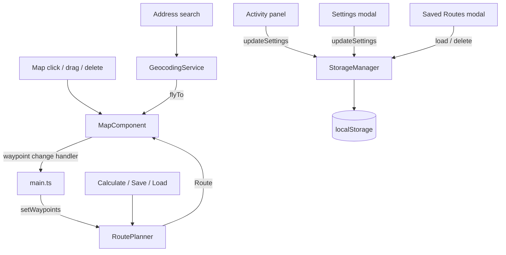

# Cardio Planner App - Architecture

## Project Overview
A TypeScript web app for planning walking, jogging, running, and cycling routes on an OpenStreetMap map. All data stays in the browser (localStorage); no account or server is needed.

## Technology Stack
- **Frontend**: TypeScript, HTML5, CSS3 (no UI framework)
- **Mapping**: Leaflet.js with OpenStreetMap tiles
- **Tables**: Tabulator (saved-routes table, modular import)
- **Address search**: Nominatim (OpenStreetMap geocoding, no API key)
- **Storage**: localStorage
- **Routing**: local straight-line (Haversine) distances between waypoints
- **Build/test**: Vite, Vitest + jsdom, ESLint (typescript-eslint)

## Project Structure

```
cardio-planner/
├── index.html                 # Page shell: header, sidebars, map, #modals
├── src/
│   ├── main.ts                # Wiring: panels, events, settings, routes
│   ├── components/
│   │   ├── MapComponent.ts    # Leaflet map, click-to-add, markers, route line
│   │   ├── RoutePlanner.ts    # Waypoints, distance/duration, route info text
│   │   ├── StorageManager.ts  # Settings + routes in localStorage, validation
│   │   └── GeocodingService.ts# Nominatim address search
│   ├── ui/
│   │   ├── modal.ts           # Native <dialog> modal helper
│   │   ├── settingsModal.ts   # Language, units, theme, home location
│   │   └── savedRoutesModal.ts# Tabulator table: load / delete routes
│   ├── utils/
│   │   ├── speeds.ts          # Activity speeds, unit conversions, speed basis text
│   │   ├── format.ts          # escapeHtml, formatDuration, date formatting
│   │   ├── waypoints.ts       # Waypoint limit, map-click decision, coordinates
│   │   └── savedRoutes.ts     # Stored routes -> table rows, route validation
│   ├── i18n/                  # en, es, zh-CN, zh-TW dictionaries + t()
│   ├── types/index.ts         # Shared types (UserSettings, Route, ...)
│   └── styles/global.css      # Theme tokens (light/dark), layout, modals
└── docs/
```

Unit tests (`*.test.ts`) sit next to the code they test.

## Components

### MapComponent
- Creates the Leaflet map at the stored home location.
- Owns click-to-add: one map click handler, attached once in `init()`.
- Ignores the map click that can follow a marker drag, and stops at the waypoint limit.
- Draggable markers (green start, blue middle, red end) with a delete link in the popup.
- Reports every waypoint change through one change handler (the single source of truth).
- Draws the calculated route (GeoJSON `[lon, lat]` converted to Leaflet `[lat, lng]`).

### RoutePlanner
- Keeps the waypoint list and the current calculated route.
- Any waypoint change clears the current route, so a stale route is never saved.
- Distance = sum of Haversine segments; duration = distance / effective speed.

### StorageManager
- Loads settings with per-field validation and migration (corrupt data falls back to defaults).
- `updateSettings()` merges, normalizes, and saves partial changes.
- Saves, loads, and deletes routes; corrupt route lists load as empty.

### GeocodingService
- Nominatim search on explicit user action only (button or Enter), with `accept-language` set to the UI language.

### UI modals
- **Settings modal**: language, units, theme (light/dark), home location. Changes apply on Save; Cancel/Esc discard.
- **Saved Routes modal**: sortable Tabulator table (name, distance, estimated time at the current speed, points, date) with Load and Delete (with confirmation).

## Data Flow



## Storage Schema

Settings key: `walk_planner_settings`

```typescript
interface UserSettings {
  name: string;
  units: 'metric' | 'imperial';
  language: 'en' | 'es' | 'zh-CN' | 'zh-TW';
  activityType: 'walking' | 'jogging' | 'running' | 'bicycling';
  customSpeed?: number;   // km/h
  customPace?: number;    // min/km, overrides customSpeed and activityType
  homeLocation: { lat: number; lng: number; zoom: number };
  darkMode: boolean;
}
```

Routes key: `walk_planner_routes` (array)

```typescript
interface Route {
  id: string;
  name: string;
  waypoints: { location: [number, number]; name?: string }[]; // [lat, lon]
  distance: number;   // meters
  duration: number;   // seconds, at the speed used when saved
  geometry: { type: 'LineString'; coordinates: [number, number][] }; // [lon, lat]
  createdAt: string;  // ISO-8601
}
```

## Speed Resolution
Custom pace > custom speed > activity default (walking 5, jogging 8, running 12, bicycling 20 km/h) > fallback 5 km/h. Values are stored in canonical units and converted for display.
